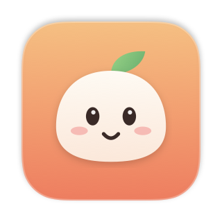
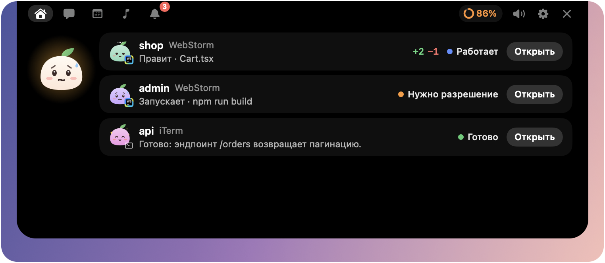
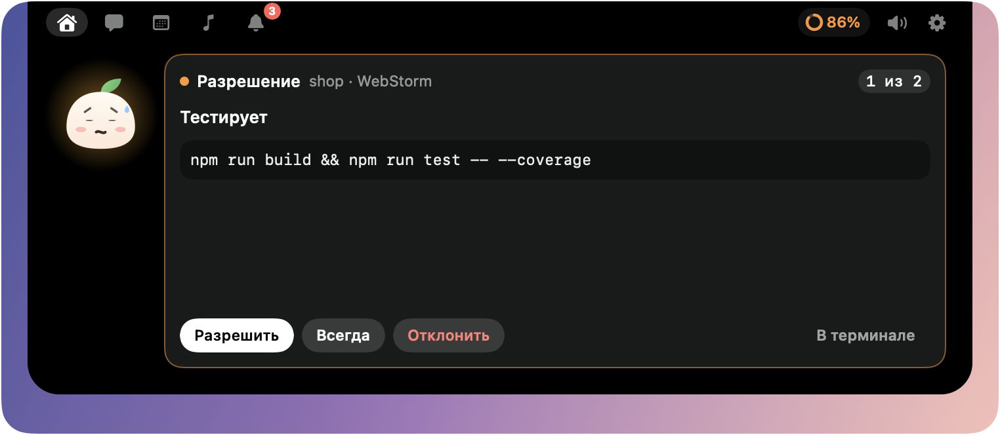
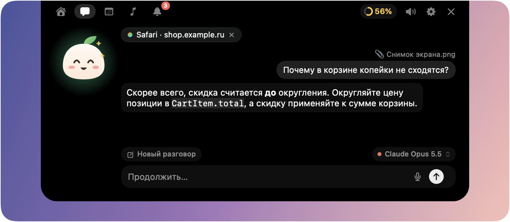
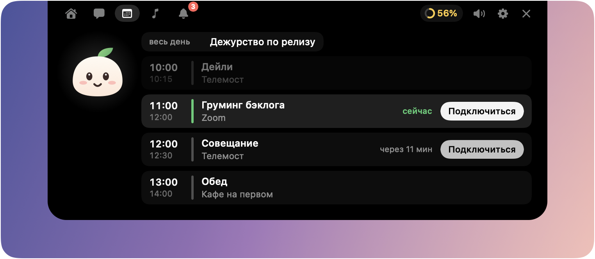
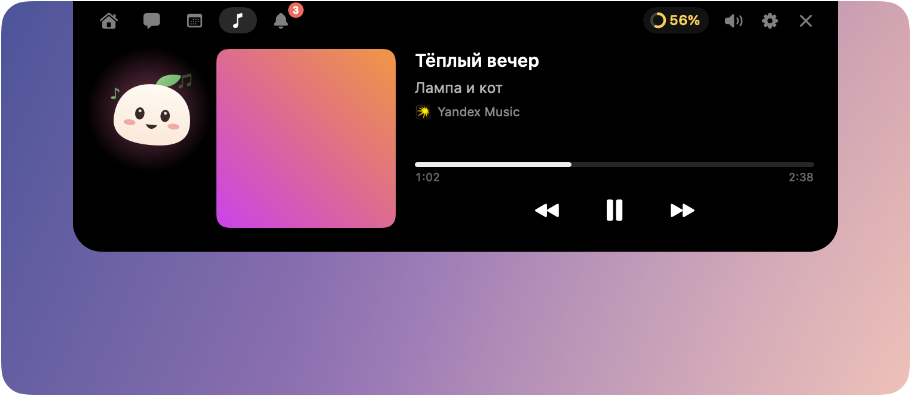
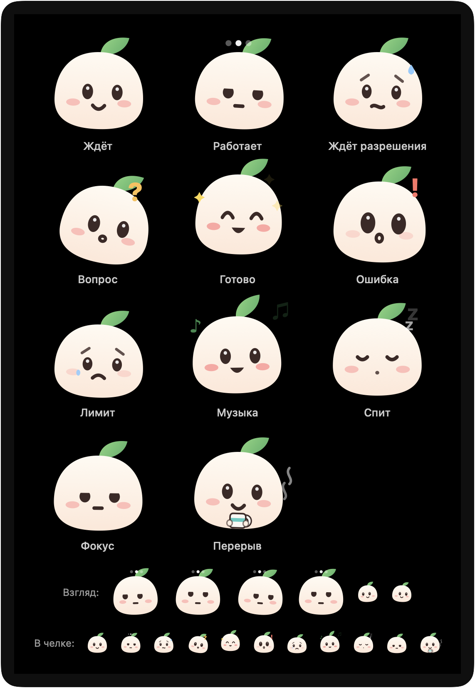
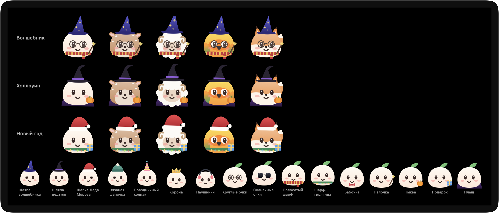

<div align="center">



# Mely

**Маленький помощник, который живёт в челке твоего Mac и присматривает за Claude Code**

[](https://github.com/cryzer-dev/Mely/releases/latest)
[](https://github.com/cryzer-dev/Mely/actions/workflows/ci.yml)


[](LICENSE)

[**Скачать**](https://github.com/cryzer-dev/Mely/releases/latest) · [Возможности](#возможности) · [Установка](#установка) · [Сборка из исходников](#сборка-из-исходников)

<br>



</div>

<br>

Mely показывает в челке всё, что происходит прямо сейчас. Работают ли твои сессии Claude Code, ждёт ли какая-то из них разрешения, сколько осталось лимитов, что в календаре и что играет. Не нужно переключаться в терминал, чтобы нажать «Разрешить»: это можно сделать прямо из челки. На Mac без челки Mely живёт плашкой у верхнего края экрана.

## Возможности

### Claude Code под рукой

- **Все сессии в одном месте** — из терминала, iTerm, WebStorm и других IDE JetBrains. По каждой видно, что она делает сейчас, сколько строк поменяно и в каком она состоянии.
- **Разрешения и вопросы** прямо в челке: «Разрешить», «Всегда», «Отклонить» или ответ на вопрос Claude. Пока запрос ждёт, челка не закрывается.
- **«Открыть»** переносит в нужное окно IDE или терминала. Закрыл терминал — сессия пропадает из челки сама.
- **Лимиты плана Claude**: в свёрнутой челке — 5-часовое окно, а если лимит кончился, через сколько он вернётся. Недельное окно и время сброса обоих — в раскрытой челке.

<p align="center"></p>

### Чат с Claude

- **⌃⌥Пробел** из любого приложения — челка открывается с полем ввода. Mely подхватывает окно, в котором ты был, и Claude отвечает с учётом него.
- Работает **по подписке Claude** (через установленный Claude Code, без ключа) или по своему ключу API.
- Файлы и картинки можно перетащить прямо в челку.

<p align="center"></p>

### Твой день

- **Календарь на сегодня**: «Подключиться» открывает встречу сразу в Телемосте, Zoom или Teams, ссылку на любой другой созвон — в браузере. Напоминание о встрече висит, пока её не закроешь или она не закончится.
- **Уведомления**: сообщения из Telegram, Яндекс Мессенджера, Телемоста и браузеров — короткой строкой в челке, а новые, перенесённые и отменённые встречи остаются на вкладке «Уведомления», даже если ты отвлёкся.
- **Мини-плеер** для Яндекс Музыки, Apple Music, звука и видео из браузера.

<p align="center"></p>
<p align="center"></p>
<p align="center"></p>

### Сама Mely

У Mely есть настроение: она работает вместе с Claude, волнуется, когда ждёт твоего разрешения, радуется готовому и засыпает, когда всё тихо. Она следит глазами за курсором, отзывается на клики, её можно вытащить из челки на рабочий стол. Если бросить Mely на окно, она спросит Claude про это окно.

<p align="center"></p>

Пять обликов (персик, оленёнок, ягнёнок, аратинга, лисёнок) со своими цветами, гардероб и сезонные наряды на Хэллоуин и Новый год.

<p align="center"></p>

### И ещё

- Свои звуки с регулятором громкости. В режиме фокусировки Mely молчит.
- Гибкое поведение челки: открывать при наведении, когда закрываться (и сразу ли при клике мимо), когда прятаться, на каком экране жить.
- **Не мешает полноэкранным приложениям**: поверх видео, игр и презентаций — только запросы разрешений и вопросы Claude, а можно и вовсе ничего, пока не выйдешь из полноэкранного режима.
- Каждую интеграцию можно выключить. Выключенная ничего не делает в фоне и не просит разрешений.
- **Обновляется сама**: раз в день Mely проверяет, не вышла ли новая версия, и предлагает обновиться одной кнопкой.

<p align="center"></p>

### Скоро

- Голосовой ассистент «Привет, Мэли»
- Вопросы Claude про открытую страницу браузера, загрузки, локальные dev-серверы
- «Бельевая верёвка» для скриншотов: быстро передать скрин в Claude Code

## Установка

1. Скачай `Mely-X.Y.Z.dmg` со страницы [последнего релиза](https://github.com/cryzer-dev/Mely/releases/latest).
2. Открой его и перетащи Mely в «Программы».
3. Запусти Mely. Первый раз macOS скажет, что не может проверить разработчика: Mely подписана своим сертификатом, а не платным Apple Developer ID.
   - Открой **Системные настройки → Конфиденциальность и безопасность**.
   - Внизу нажми **«Всё равно открыть»** напротив Mely.
   - Это нужно сделать только один раз: дальше обновления ставятся без вопросов.
4. В настройках Mely (шестерёнка в челке) включи нужные интеграции. Чтобы видеть сессии, нажми «Подключить» у Claude Code: Mely покажет, что именно добавит в `~/.claude/settings.json`, и запишет только после твоего «Применить».

Нужны **macOS 15 Sequoia** или новее и Mac на **Apple Silicon**.

### Какие разрешения и зачем

| Разрешение | Для чего |
|---|---|
| Универсальный доступ | Заголовок окна, про которое спрашиваешь в чате |
| Полный доступ к диску | Читать уведомления мессенджеров |
| Календари | События на сегодня |
| Автоматизация | Открывать встречи и переключать приложения |

Каждое разрешение запрашивается, только когда включаешь интеграцию, которой оно нужно.

### Статистика

Mely отправляет анонимную статистику через [TelemetryDeck](https://telemetrydeck.com), чтобы было понятно, что в ней нужно, а что нет:

- **при запуске** — версии Mely и macOS, модель Mac и язык системы;
- **раз в день, на следующий день** — какие интеграции включены и сколько раз за день раскрывали челку, открывали каждую вкладку и подключались к встречам.

Никогда не отправляются тексты сообщений и чата, названия встреч, ссылки, имена проектов и путей, отправители уведомлений. Пользователь — случайный идентификатор, не связанный с аккаунтом или почтой. Выключить: Настройки → Основные → Статистика; после этого не уходит ничего, а накопленные счётчики стираются.

## Удаление

1. В настройках Mely → «Интеграции» → Claude Code нажми **«Отключить hooks»**. Mely уберёт свои хуки из `~/.claude/settings.json` и вернёт строку состояния, которая была до неё.
2. Выйди из Mely (значок в строке меню → «Выйти из Mely») и перетащи её из «Программ» в Корзину.
3. Удали данные Mely: папку `~/.mely` и её настройки.

   ```sh
   rm -rf ~/.mely
   defaults delete dev.mely.app
   ```

4. Если чат работал по своему ключу API, удали в «Связке ключей» запись `dev.mely.app.claude-chat`.

## Сборка из исходников

```sh
git clone https://github.com/cryzer-dev/Mely.git && cd Mely
scripts/make-dev-cert.sh              # один раз: свой сертификат подписи «Mely Dev»
scripts/build-app.sh --dev --install  # собрать и поставить «Mely Dev» рядом с основной Mely
scripts/test.sh                       # тесты
```

Как устроены сборка, Mely Dev, снимки интерфейса и выпуск версий — в [CONTRIBUTING.md](CONTRIBUTING.md).

## Лицензия

[MIT](LICENSE). Чужой код и его лицензии перечислены в [THIRD_PARTY_NOTICES.md](THIRD_PARTY_NOTICES.md).

Mely — независимый проект, он не связан с Anthropic. Claude и Claude Code — товарные знаки Anthropic.

Сделал [cryzer](https://github.com/cryzer-dev).
